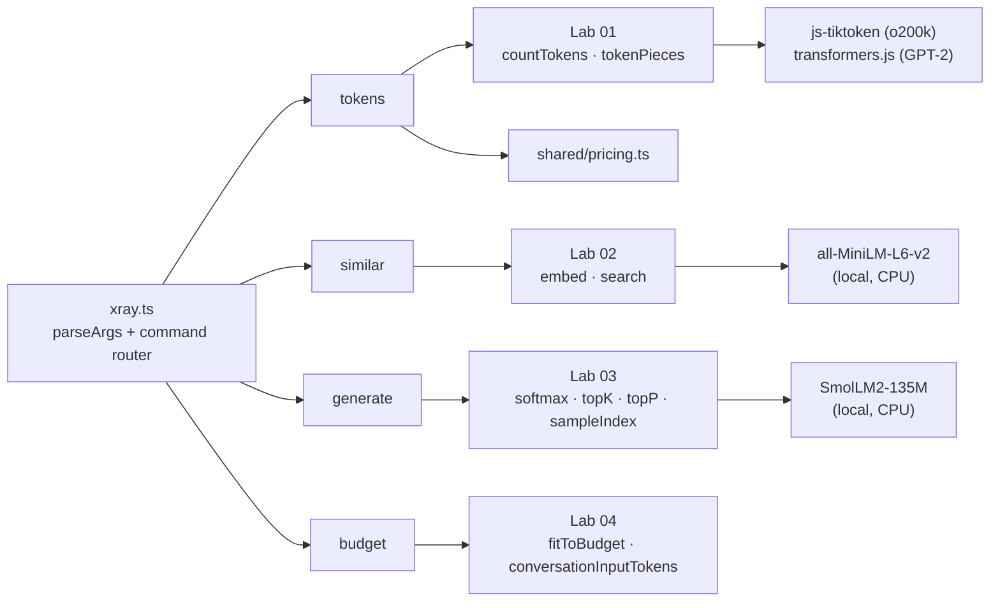

# Phase 1 project: LLM X-ray CLI

**Time budget:** 2–2.5 h · **Keys needed:** none · **Builds on:** Labs 01–04 · **Feeds into:** Phase 2 (your cost meter reuses `tokens`; the chat backend reuses `budget`)

A command-line tool that shows what an LLM actually sees, decides and costs. It's the instrument you'll keep using to sanity-check prompts and bills for the rest of the course.

## Spec
```
xray tokens   <text> | --file <path>   [--out <tokens>]
xray similar  --query <q> --file <docs.txt> [--k 3] [--min-score 0.3]
xray generate <prompt> [--temperature 1] [--top-k 0] [--top-p 1] [--max-tokens 30] [--seed 42] [--show-probs]
xray budget   --file <conversation.json> [--window 4096] [--reserve 1024]
```

| Command | What it must do |
|---|---|
| `tokens` | Token counts for GPT-2 and `o200k_base`, chars/token, visible token pieces, and a per-model cost table (input = counted tokens, output = `--out`). |
| `similar` | Semantic top-k over the lines of a file with scores. Warns when the best score is below `--min-score` ("probably nothing relevant") and when the top two are nearly tied. |
| `generate` | Runs SmolLM2-135M locally and **streams** tokens as they are produced using *your* sampler. Prints TTFT and tokens/s. `--show-probs` shows each sampled token's probability. |
| `budget` | Applies your sliding-window policy to a conversation JSON. Lists dropped messages, then shows the "billed input vs conversation size" multiple. |

Arg parsing, help text and the error path are already in [`starter/xray.ts`](starter/xray.ts). You implement the four command bodies using your lab code.

## Architecture


## Acceptance criteria
Automated in [`check.ts`](check.ts). Run against your code:
```bash
npx tsx phase-01-how-llms-work/project/check.ts starter
```
- **AC1** `tokens "Hello world"` prints `o200k: 2 tokens`, the pieces `[Hello][ world]`, and a cost row for `claude-sonnet-5-5`.
- **AC2** `similar --query "how do I undo a bad deployment?"` ranks the rollback doc first, though it shares almost no keywords with the query.
- **AC3** An off-topic query ("best pizza toppings in Naples") triggers the "probably nothing relevant" warning.
- **AC4** `generate "The capital of France is" --temperature 0` streams `Paris` and prints `TTFT … ms` and `tokens/s`.
- **AC5** `budget --window 400 --reserve 150` drops the oldest turns. These include the one where the user says their name, which the last message asks about.
- **AC6** An unknown command exits with code 2 and prints usage.

The reference implementation lives in [`reference/`](reference/xray.ts). Look only after your own attempt passes, or after 45 minutes stuck on one AC.

## Stretch goals (optional)
1. **Provider-accurate counts** (+30 min, needs a key from Phase 2): add `--provider anthropic` that calls the Messages API `count_tokens` endpoint, and print the delta vs `o200k`.
2. **Entropy per token** (+20 min): in `generate --show-probs`, colour each token by the distribution's entropy. You'll see the model "hesitate" at decision points.
3. **Summarize strategy** (+30 min): `budget --strategy summarize` replaces dropped turns with a synthetic summary message (stub now, real LLM call in Phase 2).
4. **KV cache** (+60 min, advanced): pass `past_key_values` from one forward pass into the next in `generate`. Measure the tokens/s difference.

## Self-review rubric
| Area | 1 (needs work) | 2 (solid) | 3 (senior) |
|---|---|---|---|
| Correctness | Some ACs fail | All ACs pass | All pass, plus edge cases (empty file, zero-width window, non-UTF-8 input) handled with clear errors |
| Streaming UX | Prints at the end | Streams tokens | Streams, reports TTFT separately from throughput, and you can explain why they differ |
| Cost reasoning | Hardcoded numbers | Uses the pricing table | Explains why `o200k` counts are only an estimate for Claude/Gemini, and shows the output-token share of cost |
| Code quality | Logic duplicated from labs | Imports lab modules | Lab modules are pure and testable; the CLI is a thin adapter (ports and adapters) |
| Understanding | Can run it | Can explain each number printed | Can predict the output (e.g. what T=2 does, or which turn gets dropped) **before** running it |
