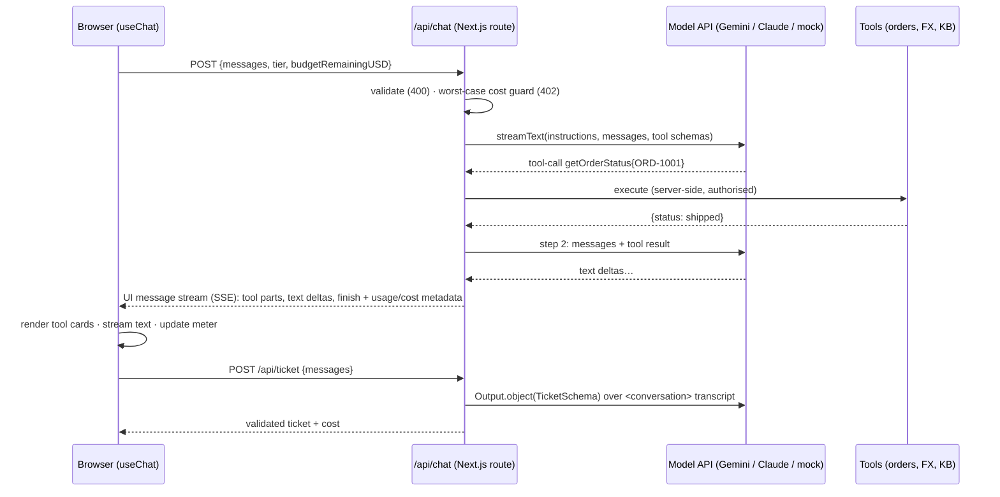

# Phase 2 project: Support Copilot, a streaming chat with tools, structured output and a cost meter

**Time budget:** 6–7 h · **Keys:** optional (runs on a mock model offline; Gemini free tier live) · **Builds on:** Labs 02–07 · **Feeds into:** Phase 3 (the knowledge-base tool becomes real RAG), Phase 4 (the tool loop becomes an agent), Phase 7 (budget and metering move server-side)

A Next.js 16 app where a user chats with a support assistant that:
- **streams** answers token by token, with a working **Stop** button;
- calls **server-side tools** (order lookup, currency conversion, knowledge-base search) and shows each tool call as a card;
- turns the conversation into a **validated support ticket** (structured output);
- shows a live **token & cost meter** per answer and per session, with a **pre-flight budget guard**.

## Run it
```bash
npm install                                   # once, at the repo root (workspaces)
npm run dev --workspace phase-02-llm-apis/project/starter      # http://localhost:3021
npm run dev --workspace phase-02-llm-apis/project/reference    # http://localhost:3020 (the finished version)
```
The app reads the **repo-root `.env`**. With a Gemini key it runs live; with `LLM_PROVIDER=mock` (or no key) it uses a deterministic mock that still calls the real tools.

## Spec
| Area | Requirement |
|---|---|
| `POST /api/chat` | Validates input (400). Pre-flight **budget guard** (402). `streamText` with tools, `stopWhen: isStepCount(5)`, `maxOutputTokens`, `abortSignal: req.signal`. Responds with the **AI SDK UI message stream**. |
| Metadata | The `finish` event carries `{ modelId, inputTokens, outputTokens, reasoningTokens, cachedInputTokens, costUSD }`, **summed across all tool-loop steps** (`part.totalUsage`). |
| Errors | Tool errors marked `UserFacingError` reach the user. Every other error is replaced by a generic message, and provider internals never reach the browser. |
| Tools | `getOrderStatus`, `convertCurrency` (from Lab 05) and **`searchKnowledgeBase`**: embed the query, cosine similarity against the KB, top 3. |
| `POST /api/ticket` | Conversation → **delimited transcript** → `Output.object(TicketSchema)` → validated ticket + its cost. |
| UI | `useChat` with `DefaultChatTransport` (body carries tier + remaining budget), tool cards with state, Stop, error + Retry, a model picker (fast/smart), the meter, and a ticket panel. |

The starter gives you the layout, CSS, model selection, mock model, pricing, schemas and the two finished tools. **You implement** (search for `TODO` in `starter/`):
- **TODO 1–4** in `app/api/chat/route.ts`: convert messages, budget guard, `streamText`, UI stream with metadata and safe errors.
- **TODO A–B** in `app/api/ticket/route.ts`: transcript, then structured output.
- **TODO C** in `lib/tools.ts`: knowledge-base semantic search.
- **TODO D** in `components/message-view.tsx`: tool cards.
- **TODO E** in `components/cost-meter.tsx`: meter totals.

## Architecture


## Acceptance criteria
Automated in [`check.ts`](check.ts). It builds the app (type-checked), starts it, and drives it over HTTP like the browser does:
```bash
npx tsx phase-02-llm-apis/project/check.ts starter            # mock model, offline
LIVE=1 npx tsx phase-02-llm-apis/project/check.ts starter     # against your .env provider
```
| AC | What is checked |
|---|---|
| AC1 | The answer streams as multiple text deltas; `finish` carries model, tokens and cost |
| AC2 | "Where is order ORD-1001?" → `getOrderStatus` runs on the server, the result is streamed, the answer says "shipped" |
| AC3 | Unknown order → `tool-output-error` with the "not found" message, and the model still answers |
| AC4 | "How long are logs retained?" → knowledge-base search returns the logs policy first |
| AC5 | A tool loop bills more input tokens than a single call (usage summed across steps) |
| AC6 | A tiny remaining budget → **402** before any model call |
| AC7 | Invalid bodies → **400** |
| AC8 | A conversation with a tool call, **ending on an assistant turn** → a valid ticket with `category: billing`, `orderId: ORD-1001` |
| AC9 | A client abort mid-stream doesn't break the server |

## Bugs found while building the reference (you'll meet them too)
1. **Ticket 500 on Gemini:** passing a chat that ends with an assistant turn as `messages` → `"Requests ending with a model turn are not supported"`. Fix: analyze conversations as **delimited data in the prompt**. That's also safer against injection. AC8 now covers it.
2. **`onError` masked tool errors**, so the user saw "Something went wrong" instead of "Order not found". Fix: a `UserFacingError` class for messages that are safe to show.
3. **React effect returned a Promise:** `useEffect(() => el.scrollIntoView(...))` crashed in the browser, because newer browsers return a Promise from `scrollIntoView`. The HTTP tests couldn't catch it, so **open the UI and click through it**.

## Stretch goals (optional)
1. **Human approval for a risky tool** (+45 min): add `issueRefund` and require approval with `toolApproval: { issueRefund: 'user-approval' }`. Render Approve/Deny buttons for the `approval-requested` state. (Phase 4 goes deep on human-in-the-loop.)
2. **Stream the ticket** (+30 min): use `streamText` + `Output.object` and render partial fields as they arrive (`useObject` or your own reader).
3. **Model fallback** (+30 min): on 429/503 from the primary model, retry once on the other tier or provider and show which model answered.
4. **Persist chats** (+60 min): save `UIMessage[]` to SQLite or Postgres in `onEnd`, and reload a chat by id.
5. **Server-side budget** (+60 min): move the session budget from the client to a per-user record on the server. The client value is trivially forgeable (Phase 7 does this properly).

## Self-review rubric
| Area | 1 (needs work) | 2 (solid) | 3 (senior) |
|---|---|---|---|
| Streaming | Waits for the full answer | Streams text; Stop works | Stop aborts upstream (`req.signal`); errors mid-stream render a retry state; you can explain why TTFT ≠ total latency |
| Tools | Logic in the prompt | Server-side tools with schemas | Tools validate and authorize input; errors are user-safe; step cap; you can explain why the model never executes anything |
| Structured output | Parses free text | `Output.object` with a schema | Nullable fields, enum descriptions, the conversation passed as delimited data, failure path returns 502 |
| Cost | No numbers | Per-answer cost shown | Usage summed across steps, reasoning and cache shown, pre-flight worst-case guard; you can say where the guard is insufficient (client-tracked budget) |
| Security | Keys or internals reach the browser | Keys server-side only | Generic errors by default, untrusted-data delimiting, `instructions` not user-editable, a plan for per-user budgets and authorization |
| Testing | Manual only | ACs pass on mock | ACs pass on mock **and** live; you clicked through the UI and checked the console |
