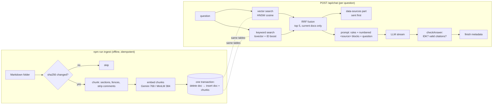
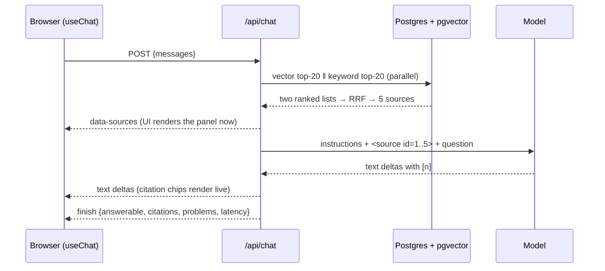

# Phase 3 project: Docs Chat, chat with your docs, with citations you can check

**Time budget:** 7–8 h · **Keys:** optional (offline: local MiniLM embeddings + a deterministic mock model; live: Gemini free tier) · **Needs:** Docker Postgres (`npm run db:up`) · **Builds on:** Labs 01–06 · **Feeds into:** Phase 4 (search becomes an agent tool), Phase 5 (the same search exposed as an MCP server), Phase 7 (evals in CI, tracing, caching)

A Next.js 16 app that answers questions about a folder of Markdown docs (the Acme handbook from the labs):
- an **ingestion CLI** that syncs the folder into Postgres + pgvector. It is **idempotent**: unchanged files are skipped by content hash, edited files are re-chunked atomically, deleted files are removed;
- **hybrid retrieval** (pgvector + full-text, fused with RRF), with deprecated documents filtered out;
- a **streaming chat** that sends the retrieved sources **before** the first token, answers only from them, cites them inline as `[n]`, and says **"I don't know"** when the docs don't cover the question;
- **post-stream checks**: invented citation numbers and uncited answers are flagged in the message metadata and shown in the UI;
- a **`/api/search`** endpoint for debugging retrieval, and an **eval CLI** that scores the golden set and exits non-zero below thresholds (a CI gate).

## Run it
```bash
npm install                    # once, at the repo root (workspaces)
npm run db:up                  # Postgres 18 + pgvector in Docker, port 5433
cd phase-03-rag/project/starter      # or reference/ for the finished version
npm run ingest                 # sync the handbook into Postgres (run it again: everything is "unchanged")
npm run dev                    # http://localhost:3031 (starter) · 3030 (reference)
npm run eval                   # retrieval metrics on the 35-question golden set
npm run eval -- --answers      # + answer accuracy (calls the model 35 times; use a real model)
```
The app and scripts read the **repo-root `.env`**. With a Gemini key: Gemini embeddings (768 dims) and `gemini-3.5-flash-lite`. With `LLM_PROVIDER=mock` or no key: local MiniLM (384 dims) on your CPU and the mock model. The two embedders write to **different tables** (`kb_chunks_768`, `kb_chunks_384`), so switching providers means running `npm run ingest` once for the new one. Vectors from different models never mix.

## Spec
| Area | Requirement |
|---|---|
| Schema (`lib/db.ts`, given) | `kb_docs_<dims>` (id, title, status, updated, **hash**) and `kb_chunks_<dims>` (content, section, `vector(dims)`, generated `tsvector`), with HNSW + GIN indexes and `ON DELETE CASCADE`. |
| Chunking (`lib/chunk.ts`, given) | Lab 01's structure-aware chunker: H2 sections, fences and tables kept whole, ≤ 200 tokens, a "Title > Section" header in the embedded text, **HTML comments stripped**. |
| Ingestion (`lib/ingest.ts`) | `syncFolder()`: compare sha256 hashes, skip unchanged, **embed outside the transaction**, then replace a document's chunks in one transaction, delete vanished documents, and return `{added, updated, unchanged, removed, chunks}`. |
| Retrieval (`lib/retrieve.ts`) | `vectorSearch` (given), `keywordSearch` (OR'd lexemes + exact-identifier boost), `rrf`, `hybridSearch` (both searches **in parallel**). Only `status = 'current'` documents. |
| `POST /api/chat` | Validates input (400/413). Retrieves for the latest question → writes a **`data-sources`** part → `streamText` with grounded instructions and numbered `<source>` blocks → merges the UI stream. `finish` metadata: `{answerable, citations, problems, modelId, embedder, retrievalMs, tokens}`. |
| Answer checks (`lib/answer.ts`) | `checkAnswer()`: detect the "I don't know" sentinel, keep only valid `[n]` citations, list problems. |
| `GET /api/search?q=&k=` | Retrieval only, no LLM. Returns hits with fused rank and per-retriever ranks. |
| Eval (`scripts/eval.ts`, given) | recall@5 and MRR at **section level**; `--answers` adds answer accuracy (expected facts, forbidden facts, refusals, citation validity). Prints a JSON line and exits 1 below `--min-*` thresholds. |
| UI (given) | Citation chips that focus the source in the side panel, cited sources highlighted and uncited ones dimmed, invalid citations shown in red, a "not in the docs" badge, retrieval and total latency. |

**You implement** (search for `TODO` in `starter/`):
- **TODO 1–3** in `lib/ingest.ts`: the hash-based sync.
- `keywordSearch`, `rrf` and `hybridSearch` in `lib/retrieve.ts` (port them from Lab 03 and add the join on documents).
- `checkAnswer` in `lib/answer.ts`.
- **TODO 1–4** in `app/api/chat/route.ts`: retrieve, send sources, stream, attach the checks as metadata.

## Architecture




## Acceptance criteria
Automated in [`check.ts`](check.ts). It ingests into the **test database**, builds the app (type-checked), starts it, and drives it over HTTP like the browser does:
```bash
npx tsx phase-03-rag/project/check.ts starter            # mock model + local embeddings, offline
LIVE=1 npx tsx phase-03-rag/project/check.ts starter     # Gemini embeddings + model from .env
```
| AC | What is checked |
|---|---|
| AC1 | Ingestion: first run adds 11 docs; re-run embeds **0** chunks; edit one + delete one → exactly 1 updated, 1 removed |
| AC2 | No chunk contains an HTML comment or the hidden "ignore all previous instructions" payload |
| AC3 | `/api/search?q=E-4290` → `api-errors.md` first; refund searches never return the deprecated 2024 policy; missing `q` → 400 |
| AC4 | `data-sources` arrives **before** the first text delta; the answer streams with valid `[n]` citations pointing at the rollback section |
| AC5 | "Office wifi password?" / "Who is the CEO?" → starts with "I don't know", `answerable: false` |
| AC6 | The refund answer says 30 days, never the deprecated 14 days |
| AC7 | Bad bodies → 400; assistant-last → 400; 2,500-char question → 413 |
| AC8 | `eval` prints JSON metrics, passes recall@5 ≥ 0.9 and MRR ≥ 0.7, and **exits non-zero** when a threshold is impossible |

## Measured on the reference (2026-10-29, this laptop: i7-6820HQ CPU, no GPU)
| | Local (MiniLM 384, CPU) | Gemini (`gemini-embedding-2` 768) |
|---|---|---|
| Ingest 11 docs → 54 chunks | 1.9 s | 10.8 s (rate-paced to 90 texts/min) |
| Re-ingest, nothing changed | 0.1 s, 0 embeddings | 0.1 s, 0 embeddings |
| Retrieval recall@5 / MRR (golden set, section level) | 1.000 / 0.823 | 0.984 / 0.948 (one miss: `E-4290` has two relevant sections and only one made the top 5) |
| Retrieval latency per question (warm, embed + both searches + RRF) | 5–9 ms | 510–1,005 ms (one embedding API call) |
| Answer accuracy (`eval --answers`, `gemini-3.5-flash-lite`) | n/a (the mock is not a model) | **0.971** (34/35): all 3 refusals correct, 0 citation problems. The miss is q07, which said the key "may have been revoked" but left out the code `E-4003` |

Time to first token from `gemini-3.5-flash-lite` on the free tier was **16–20 s** on the evening this was measured, even for "say hi in 3 words". That's provider queueing, not your code. Check it in isolation before you optimise your pipeline. Retrieval took < 1 s of the total.

## Bugs found while building the reference (you'll meet them too)
1. **Thinking off → citations gone.** Setting `reasoning: 'minimal'` to cut latency made Gemini drop the `[n]` markers while the facts stayed correct. `checkAnswer` flagged "answer has no citations" right away. Any model or setting change can quietly break grounding, and that's why the checks and the eval exist.
2. **`embedder.dims` lives in the table name.** The first schema draft had one `documents` table shared by both embedders. After switching to Gemini, every document hash would have matched, ingestion would have skipped everything, and the 768-dim chunks table would have stayed empty, so search returned nothing and nobody got an error. The fix keys docs **and** chunks by embedder size. AC1 asserts there is exactly one chunks table per run.
3. **The build stopped on a security notice.** `next build` on Next.js 16.4.0 reported critical advisories (RCE in image optimisation and `use cache`). `npm audit` confirmed them, and the course now pins `next@^16.4.3`. Run `npm audit` before you ship any phase project.
4. **A test that passes for the wrong reason.** AC2 ("no HTML comments in the index") passed on the empty starter because an empty table contains no comments. It now asserts the table is non-empty first. Watch for vacuous passes in your own eval suites.

## Stretch goals (optional)
1. **Reranking** (+45 min): retrieve 20 with hybrid search, rerank with the Lab 04 cross-encoder, keep 5. Run `eval` before and after, and keep it only if MRR improves enough to pay for the ~2 s/query CPU cost.
2. **Follow-up questions** (+60 min): "and on the Team plan?" retrieves nothing useful on its own. Rewrite the question with the conversation (a cheap `generateText` call) before retrieving, and show the rewritten query in the UI.
3. **Citation-level verification** (+60 min): for each cited sentence, ask a small model (or Phase 1's NLI idea) whether the cited source supports it, and flag unsupported sentences.
4. **Watch mode** (+30 min): `npm run ingest -- --watch` re-syncs on file changes (`fs.watch`), which is cheap thanks to the hashes.
5. **Bring your own docs** (+30 min): point `--dir` at your own project's docs and write 10 golden questions for them. That eval is the most valuable artifact you'll produce in this phase.
6. **Per-tenant isolation** (+60 min): add a `tenant_id` to both tables, filter on it in every query, and write a test proving tenant A can never retrieve tenant B's chunks.

## Self-review rubric
| Area | 1 (needs work) | 2 (solid) | 3 (senior) |
|---|---|---|---|
| Ingestion | Drops and reloads everything | Hash-skip unchanged docs | Atomic per-document replace, embeds outside transactions, removes vanished docs, one table per embedder; you can explain what happens if the process dies mid-run |
| Retrieval | Vector only | Hybrid + RRF | Status filters in SQL, identifier boost, parallel queries, a `/api/search` you actually use for debugging, numbers to justify each component |
| Grounding | Context pasted into the prompt | Numbered sources, inline citations | Sources delimited as untrusted data, an "I don't know" path, citations validated after streaming and shown honestly in the UI |
| Evaluation | "Looks right" | recall@k on a golden set | Section-level labels, retrieval and answer metrics separated, thresholds that fail CI, a habit of running eval before and after every change |
| Security | Comments and injected text go straight to the model | Comments stripped | Injection tested, sources can't fake `</source>`, deprecated docs filtered in SQL rather than by prompt, a plan for per-tenant filtering |
| Testing | Manual only | ACs pass on mock | ACs pass on mock **and** live; you clicked citation chips in the UI and checked the console |
