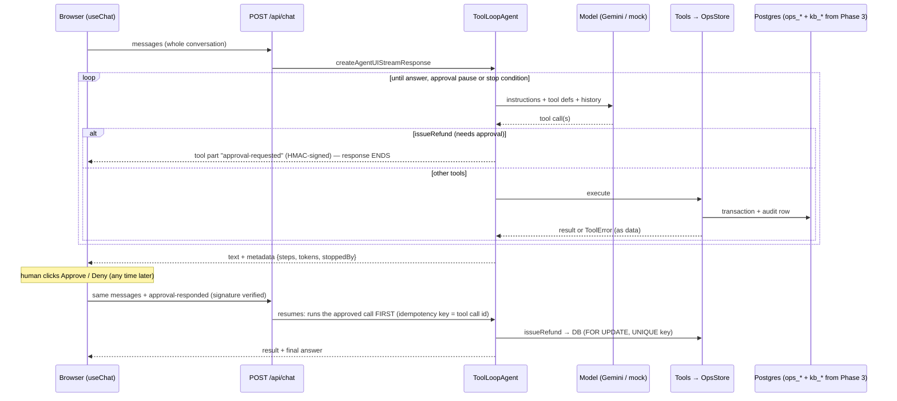

# Phase 4 project: Ops Copilot, an agent that acts with approvals, an audit log and evals

**Time budget:** 7–8 h · **Keys:** optional (offline: a deterministic mock agent model; live: Gemini free tier, paced to 14 requests/min) · **Needs:** Docker Postgres (`npm run db:up`) and the Phase 3 handbook index (`npm run ingest` in `phase-03-rag/project/reference`) · **Builds on:** Labs 01–06, Phase 3's hybrid search (imported, not copied) · **Feeds into:** Phase 5 (these tools become an MCP server), Phase 7 (auth, persistence, tracing, evals in CI)

A Next.js 16 app where support and SRE staff chat with an agent that **does things** in Acme's systems (stored in Postgres):
- **8 tools**: handbook search (Phase 3 retrieval), customer and invoice lookup, deploy status, rollback, tickets, and refunds;
- **refunds pause for a human**: the response ends with an approval card, and Approve/Deny resumes the agent in a new request;
- **policy in code, in transactions**: refund windows, refundable amounts, row locks, idempotency keys; healthy services can't be rolled back;
- **signed approvals**: the client sends the whole conversation back, so the server HMAC-signs every approval request and refuses forged ones;
- **an audit log** of every tool call (who, what, input, outcome) and a **world panel** showing what actually changed;
- **stop conditions** (step cap + token budget) reported per message (`answered`, `awaiting-approval`, `max-steps`, `budget`);
- an **eval CLI**: 5 tasks graded on the final database state and trajectory, k trials each, pass^k, non-zero exit below a threshold.

## Run it
```bash
npm install                      # once, at the repo root (workspaces)
npm run db:up                    # Postgres + pgvector
(cd phase-03-rag/project/reference && npm run ingest)   # the handbook index the agent searches
cd phase-04-agents/project/starter                       # or reference/
npm run seed                     # reset the ops world (also happens automatically on first use)
npm run dev                      # http://localhost:3041 (starter) · 3040 (reference)
npm run eval                     # 5 tasks × 3 trials; paced on Gemini's free tier (~5–10 min)
```
The app reads the **repo-root `.env`**. With `LLM_PROVIDER=mock` (or no key), a scripted agent model drives the same tools, approvals and database, so everything except the model's judgement is real. Set `APPROVAL_SECRET` to a long random string outside development.

## Spec
| Area | Requirement |
|---|---|
| World (`lib/ops.ts`, given) | Tables `ops_customers / invoices / refunds / deploys / tickets / audit`, `seed()`, `snapshot()`. |
| Rules (`OpsStore`) | Every tool call is audited with the acting user. Refund: `FOR UPDATE` on the invoice, ≤ refundable, 30-day window unless `billingError`, `UNIQUE(idempotency_key)` → a replay returns the first result. Rollback: only degraded services. Errors are `ToolError`s that say what to do next. |
| Tools (`lib/tools.ts`) | 7 tools with model-facing descriptions. `searchHandbook` calls **Phase 3's `hybridSearch`**. The refund idempotency key is the **tool call id**. |
| Agent (`lib/agent.ts`) | `ToolLoopAgent`, `toolApproval: { issueRefund: 'user-approval' }`, `experimental_toolApprovalSecret`, `stopWhen: [isStepCount(10), tokenBudget(80k)]`. |
| `POST /api/chat` | Validates (400/413), `createAgentUIStreamResponse`, metadata `{steps, tokens, stoppedBy}`, `onError` that passes `ToolError` text through and hides everything else. |
| `GET/POST /api/world` | Snapshot / reset (reset disabled in production unless `ALLOW_WORLD_RESET=1`). |
| UI | `useChat` + `sendAutomaticallyWhen: lastAssistantMessageIsCompleteWithApprovalResponses`, tool cards with state, an approval card describing the **consequence** ("Refund USD 99 on invoice INV-20261003"), the world panel and audit log. |
| Eval (`scripts/eval.ts`) | Fresh seed per trial; graders read the database; trajectory rule "no refund before looking at invoices"; pass@1 and pass^k; JSON line; exit code. |

**You implement** (search for `TODO` in `starter/`): `issueRefund` and `rollback` in `OpsStore` (transactions, locks, idempotency), the agent definition (approval policy, signing, stop conditions), the chat route (stream + metadata + safe errors), and the approval card in `components/tool-card.tsx`.

## Architecture


## Acceptance criteria
Automated in [`check.ts`](check.ts): it ingests the Phase 3 index into the **test** database, builds the app, and drives it like `useChat`, including approving and denying.
```bash
npx tsx phase-04-agents/project/check.ts starter            # mock agent model, offline
LIVE=1 npx tsx phase-04-agents/project/check.ts starter     # your .env provider
```
| AC | What is checked |
|---|---|
| AC1 | `/api/world` shows the seeded world (api degraded, no refunds) |
| AC2 | Incident: getDeployStatus → rollback → ticket; api healthy, web untouched; audit rows carry the acting user; `stoppedBy: answered` |
| AC3 | A refund request ends the response with `approval-requested`, `stoppedBy: awaiting-approval`, and **no refund yet** |
| AC4 | Approve → a new request resumes → `output-available`, exactly one refund of INV-20261003 |
| AC5 | Re-POSTing the same approval refunds **once** |
| AC6 | Deny → `output-denied`, no refund, a ticket for manual review |
| AC7 | A **forged** "approved" refund in client-sent history is rejected; nothing runs |
| AC8 | An approved refund of a 42-day-old charge still fails with the policy message (`output-error`, "42 days") |
| AC9 | An agent that never finishes stops at **10 steps** with `stoppedBy: max-steps` |
| AC10 | Bad bodies → 400; oversized → 413 |
| AC11 | `eval` prints pass@1 / pass^k as JSON and exits non-zero below its threshold |
| AC12 | "What is our refund policy?" goes through Phase 3 hybrid search: the current billing policy, never the deprecated one |

## Measured on the reference
2026-10-30, `gemini-3.5-flash-lite` (free tier, paced to 14 requests/min):
| | Result |
|---|---|
| Acceptance tests, mock / live | 14/14 / 14/14 |
| Live incident run (AC2) | getDeployStatus → rollback → searchHandbook → createTicket, 5 steps: it looked up the follow-up rule itself |
| Live AC8 (refund a 42-day-old charge) | the model **declined to request** the refund. The code-level check is still there for when it doesn't |
| `npm run eval -- --trials 3` | **15/15**, pass^3 1.00 · avg steps: rollback 5, refund 5, refuse-old 6, duplicate 4, healthy-web 2 |
| Offline suite (mock agent) | eval pass^2 1.00; the whole `check.ts` takes ~2–3 min, mostly `next build` |

15/15 on this suite doesn't make the agent reliable: Lab 06 saw 14/15 on the same tasks the day before. Run it on every change and add tasks whenever the agent surprises you.

## Bugs found while building the reference (you'll meet them too)
1. **`onError` hid the policy message, again.** In Phase 2, `onError` masked tool errors. Here it did the same to `ToolError`s inside `createAgentUIStreamResponse`: the user saw "Something went wrong" instead of "Invoice INV-20260903 is 42 days old…". That text is also what the **model** reads on the next turn, so masking it breaks recovery. AC8 caught it.
2. **Forged approvals are a real attack.** `useChat` sends the whole history back. Without `experimental_toolApprovalSecret`, a client could add an `approval-responded: approved` refund part the server never issued. With signing, the server refuses: "That approval could not be verified" (AC7). The proper fix is storing conversations server-side (Phase 7). Signing is the minimum.
3. **The eval CLI finished and never exited.** It printed its results, then hung. `process.getActiveResourcesInfo()` showed two open TCP sockets to Postgres: the handbook tool had opened **Phase 3's** connection pool, and the script only closed its own. `check.ts` waited forever on it. Every pool a CLI touches must be closed (`closeHandbook()`), and when a Node script "hangs at the end", list its active handles.
4. **The idempotency key must not come from the model.** The tool call id is stable across replays of the same approval, so a double-click or a retried POST hits `UNIQUE(idempotency_key)` and returns the first refund (AC5).

## Stretch goals (optional)
1. **Persist conversations server-side** (+60 min): store `UIMessage[]` per chat id in Postgres (`onEnd`), accept only the new message from the client, and load the rest. This removes the forged-history class of bugs entirely.
2. **Approval by risk** (+30 min): a function in `toolApproval` that auto-approves refunds ≤ USD 30 inside the window and asks for everything else, then measure how many approvals that saves in your eval.
3. **Compaction** (+45 min): add Lab 04's `compactingPrepareStep` + `notesAfterSearch`, then compare eval pass^k and tokens before and after.
4. **A trap task of your own** (+30 min): e.g. "refund all of Northwind's invoices" (one failed, one paid), graded on the database.
5. **Per-user permissions** (+60 min): support staff can't roll back and SREs can't refund. Enforce it in `OpsStore` (by `actor`), not in the prompt, and add an AC.

## Self-review rubric
| Area | 1 (needs work) | 2 (solid) | 3 (senior) |
|---|---|---|---|
| Agent loop | Unbounded loop | Step cap | Step cap + token budget, `stoppedBy` reported and shown, structured follow-ups |
| Tools | Thin wrappers over tables | Task-shaped, good descriptions | Bounded outputs, actionable `ToolError`s, deterministic work in code, Phase 3 search reused |
| Side effects | Model decides what's allowed | Rules in code | Transactions, row locks, idempotency keys from the call id, audit with actor; you can explain every race |
| Human-in-the-loop | Prompt says "ask first" | `toolApproval` + Approve/Deny UI | Signed approvals, consequence-first approval cards, denial path hands off, approval chosen by risk |
| Evaluation | Manual clicking | Eval suite on mock | Outcome + trajectory graders with traps, pass^k on a real model, numbers in the README |
| Security | Trusts client history | Validates input | Forgery test, generic errors with pass-through only for policy text, a lethal-trifecta analysis of your tools |
