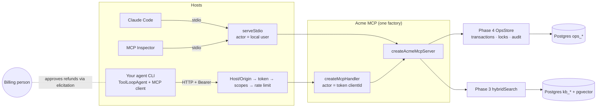
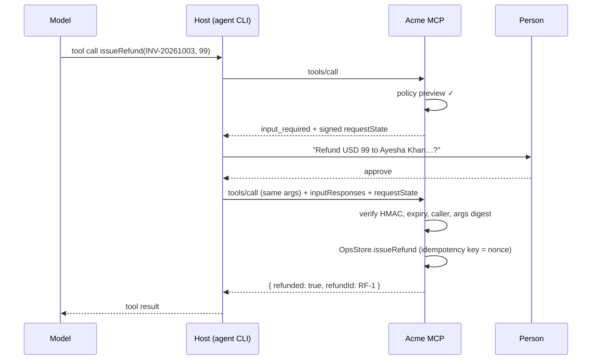

# Phase 5 project: Acme MCP, your ops tools in any AI host

**Time budget:** 4–5 h · **Keys:** optional (offline: a deterministic mock agent; live: Gemini free tier) · **Needs:** Docker Postgres (`npm run db:up`), the Phase 3 handbook index (`npm run ingest` in `phase-03-rag/project/reference`), and for AC12 the `claude` CLI · **Builds on:** Labs 01–05, Phase 4's `OpsStore` (Postgres rules, audit log) and Phase 3's hybrid search, both imported, not copied · **Feeds into:** Phase 7 (tracing, CI evals) and Phase 8 (the capstone's MCP surface, real OAuth)

Phase 4's agent could only be used from Phase 4's web app. This project moves the capabilities behind an **MCP server**, so any host can use them: **Claude Code**, the **MCP Inspector**, and **your own agent CLI**. The same server runs:
- over **stdio** for local hosts: trusted as the user who started it, audited as that user;
- over **Streamable HTTP** for remote ones: Host/Origin checks, bearer tokens, **per-tool scopes**, per-client rate limits, and the token's client id on every audit row.

It exposes **7 tools** (Phase 4's, now including a refund that asks a person via `input_required`), **resources** (`handbook://{slug}` documents, live `ops://deploys`) and a **prompt** (`incidentReview`, a slash command in Claude Code).

## Run it
```bash
npm run db:up                                            # Postgres + pgvector
(cd phase-03-rag/project/reference && npm run ingest)    # the handbook index searchHandbook uses
cd phase-05-mcp/project/starter                          # or reference/
npm run seed                                             # reset the ops world
npm run inspect                                          # Inspector CLI: list the tools over stdio
npm run http                                             # http://localhost:3050/mcp (needs ACME_MCP_TOKENS + ACME_STATE_KEY in .env)
npm run agent -- "The api is throwing errors. Fix it."   # your agent, over HTTP, with ACME_MCP_TOKEN
npm run agent -- --approve "Refund Ayesha's last charge"  # interactive by default: it asks YOU before refunding
```
Secrets live in the **repo-root `.env`** (see `.env.example`): `ACME_STATE_KEY` (≥ 32 chars, signs the approval round trip), `ACME_MCP_TOKENS` (JSON: token → client id + scopes), `ACME_MCP_TOKEN` (what the agent CLI sends). Generate random values. There are no defaults in the code on purpose.

### Use it from Claude Code (a real host)
```bash
claude mcp add acme -e ACME_ACTOR=claude-code -- npx tsx "$PWD/src/stdio.ts"    # from reference/ or starter/
claude                                    # then ask: "Is the api healthy?"  ·  /mcp shows the server  ·  try the incidentReview prompt
claude mcp add --transport http acme-http http://localhost:3050/mcp --header "Authorization: Bearer <token>"   # the HTTP variant
```
Claude Code asks before each tool call unless you allow it. A refund pauses for its **own** approval form (the elicitation), separate from Claude Code's tool permission prompt. That's two different gates: "may the agent call this tool" vs. "does a billing person approve this refund".

## Spec
| Area | Requirement |
|---|---|
| Factory (`src/server.ts`) | `createAcmeMcpServer({ sql, actor, stateKey })`: one `OpsStore(sql, actor)` per server instance, so every audit row names the caller. Tools in a fixed order, with input schemas, honest annotations and a scope each. |
| Errors | `run()`: `ToolError` → `isError` + message (the model recovers); anything else → generic message + reference id; details to stderr only. |
| Refund | Round 1: policy preview (same rules as `OpsStore`), then `input_required` with the consequence in words and a signed `requestState` (`{ nonce, argsDigest }`, 10 min, bound to method + caller). Round 2: verify digest, honour decline, refund with idempotency key `mcp:<nonce>`. |
| Resources / prompt | `handbook://{slug}` (current docs only, completable), `ops://deploys` (live, `cacheHint` 5 s private), `incidentReview(service)` embedding `ops://deploys`. |
| stdio (`src/stdio.ts`) | `serveStdio(factory)`, actor = `ACME_ACTOR` or `local:<os user>`, **no seeding at startup** (a version probe starts the process twice). |
| HTTP (`src/http.ts`) | Loopback bind, Host/Origin validation, RFC 9728 metadata, `verifyBearerToken` with audience check, 256 KB body cap, 429 + `Retry-After` per client, stateless `createMcpHandler`. |
| Agent (`src/agent.ts`) | Connects over HTTP with a token, answers `elicitation/create` through a **person** (TTY prompt or `--approve/--deny`; non-interactive defaults to deny), Lab 02's adapter, `ToolLoopAgent` with a step cap. |

**You implement** (search for `TODO` in `starter/src`): `run()`, the scope hook, the refund's two rounds in `server.ts`, and the Host/Origin guard, bearer authentication and rate limit in `http.ts`.

## Architecture



## Acceptance criteria
Automated in [`check.ts`](check.ts). It uses the **test** database, starts the servers itself, and drives them like real hosts (and like a hostile client).
```bash
npx tsx phase-05-mcp/project/check.ts starter                 # offline, mock agent model
LIVE=1 npx tsx phase-05-mcp/project/check.ts starter          # agent on your .env provider
LIVE=1 HOST=1 npx tsx phase-05-mcp/project/check.ts starter   # + Claude Code as the host (uses your Claude Code login)
```
| AC | What is checked |
|---|---|
| AC1 | stdio: the **Inspector CLI** lists all 7 tools, the `handbook://{slug}` template and the prompt; a 2026-07-28 and a 2025 client both connect |
| AC2 | `searchHandbook` goes through Phase 3 hybrid search and returns the current billing policy, never the deprecated one |
| AC3 | Resources (handbook docs, live deploys) and the `incidentReview` prompt with an embedded resource |
| AC4 | HTTP: 401 + `resource_metadata` without a token, metadata document, `Host: evil.example` → 403, 400 KB body → 413 |
| AC5 | Scopes: the support token can read but its rollback is refused (and nothing changes); the SRE's works; audit rows name each caller |
| AC6 | A refund asks a person with the consequence in words; approve → exactly one refund; decline → none, and the result says so |
| AC7 | Hostile client: pre-filled approval → asked again; swapped invoice with a valid state → refused; replayed retry → still one refund |
| AC8 | A 42-day-old charge fails at once with the policy message, and nobody is asked |
| AC9 | An unexpected failure reaches the client as a reference id, never as a password or IP |
| AC10 | Flooding → 429 with `Retry-After` |
| AC11 | **Your agent** fixes the degraded api through the server over HTTP: rollback + post-incident ticket in the DB, audited as `sre-oncall` |
| AC12 | `HOST=1`: **Claude Code** (`claude -p`, Haiku) calls the server over stdio, reports "degraded, 6.4%", and the audit log says `claude-code` |

## Measured on the reference
2026-10-31, `gemini-3.5-flash-lite` (agent) and Claude Code 2.1.300 with Haiku (host):
| | Result |
|---|---|
| Acceptance tests, mock / `LIVE=1 HOST=1` | 12/12 in 9 s / 13/13 in 36 s |
| Live agent (AC11) | getDeployStatus → searchHandbook → rollback → createTicket, 5 steps, 5,737 input tokens |
| Claude Code as host (AC12) | "The api service is **degraded** at version 2026.10.15-2 … error rate of 6.4%", 3 turns, USD 0.0042, ~10 s |
| Starter | fails cleanly: 3 pass (setup and the given parts), 9 fail |
| Tool definitions in every request | 7 tools = 699 tokens (the labs' env server: 6 tools = 510) |

## Bugs and surprises found while building it
1. **`@ai-sdk/mcp` loses `isError`.** Its tools hand an error result to the model as ordinary `content`, indistinguishable from success unless the model reads the text. The agent here uses Lab 02's adapter, which throws, so the AI SDK reports a tool error.
2. **Startup side effects run twice.** `versionNegotiation: 'auto'` probes a stdio server on a short-lived extra copy of the process. The first `stdio.ts` seeded the database on startup, and two seeds can race. Seeding moved to `npm run seed`.
3. **`fetch` can't send a fake `Host` header**, so the first DNS-rebinding test passed for the wrong reason. AC4 uses `node:http`.
4. **Approving is not authenticating.** The elicitation is answered by the host. A malicious host can answer "yes", so the server must still check scopes (`billing:refund`), bind the approval to the caller and the exact arguments, and keep the policy checks in `OpsStore`.

## Stretch goals (optional)
1. **Real OAuth** (+2 h): run a local authorization server (e.g. better-auth or Keycloak in Docker), issue JWTs with `aud = http://localhost:3050/mcp`, verify them with `jose` in the token verifier, and connect Claude Code through the browser login flow.
2. **URL-mode elicitation for large refunds** (+60 min): above USD 200, return `inputRequired.elicitUrl` pointing at a page on *your* server where the approver logs in; finish the refund there.
3. **Tool pinning in your agent** (+30 min): add Lab 05's `guardedTools` and a pins file to the agent CLI; refuse to start if the server's definitions changed.
4. **Change notifications** (+45 min): after a rollback, publish `resources/updated` for `ops://deploys` via the handler's event bus, and have a client subscribed with `subscriptions/listen` refresh it.
5. **Observability** (+45 min): put the trace context from `_meta` (`traceparent`) on your logs, so one agent run can be followed from host to SQL. Phase 7 does this properly.

## Self-review rubric
| Area | 1 (needs work) | 2 (solid) | 3 (senior) |
|---|---|---|---|
| Primitives | Everything is a tool | Tools + resources | Tools, resources and prompts chosen by who controls them; stable order, schemas, honest annotations |
| Errors | Raw exceptions reach the client | `isError` for policy errors | Policy text to the model, reference ids for bugs, nothing internal leaks, protocol errors for bad requests |
| Transport security | Listens on 0.0.0.0, no auth | Bearer tokens | Loopback, Host/Origin, audience-checked tokens, scopes per tool, rate limits, metadata for discovery |
| Human approval | Prompt says "ask first" | `input_required` + elicitation | Signed state bound to args and caller, policy before people, idempotent retries, decline paths, URL mode for high risk |
| Host side | Connects to everything | Namespaced tools, closes clients | Pins and scans servers, counts context cost, reasons about the trifecta per session |
| Proof | Manual clicking | Inspector + SDK client tests | Automated ACs incl. hostile-client cases and a real host, numbers in the README |
